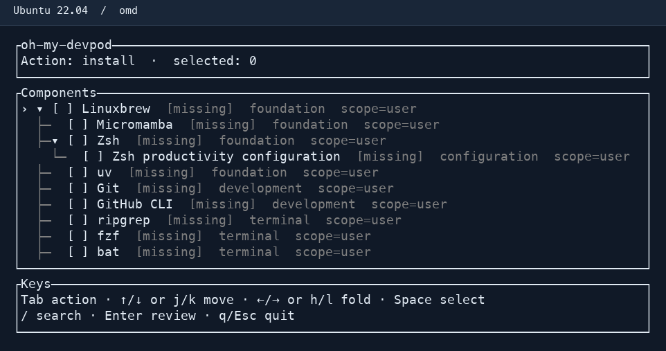

<p align="center">
  
</p>

<p align="center"><strong>English</strong> · <a href="./Readme.osc.md">简体中文</a></p>

**oh-my-devpod (OMD)** installs development tools for your own Ubuntu account. Select a tool in the terminal and review its dependencies before anything is installed. Supported systems are **Ubuntu 20.04, 22.04, 24.04 and 26.04 LTS on x86_64**.

[Quick start](#quick-start) · [Switch sources](./docs/guide.md#switch-sources) · [Update OMD](./docs/guide.md#update) · [Shared servers](./docs/guide.md#shared-servers)



Select LazyVim with `Space`; OMD also checks its parent components, Neovim and Linuxbrew. Press `Enter` to review the full dependency plan: Linuxbrew, Git, Neovim, then LazyVim on a fresh account. Press `Esc` to go back or `Enter` again to install.

## Quick start

From your Ubuntu account, install the upstream release through GitHub. On a fresh server, check the [system prerequisites](./docs/guide.md#prerequisites).

```bash
curl -fsSL https://raw.githubusercontent.com/zhangdw156/oh-my-devpod/main/install/bootstrap.sh | bash
```

The installer verifies the release checksum and opens the TUI. Run `omd` to open it again. [Gitee mirrors and npm installation](./docs/guide.md#install)

## Preview a plan

```bash
omd --plan install lazyvim
```

The plan for a fresh account lists Linuxbrew, Git, Neovim and LazyVim in that order. On a shared server, each account has its own `~/.linuxbrew`. Packages you already installed there can satisfy dependencies and stay under your control.

## Component catalog

| Choose tools for | Examples |
| --- | --- |
| Shell and environments | Zsh with Oh My Zsh and Powerlevel10k, uv, Micromamba |
| Editing and development | Neovim, LazyVim, Git, GitHub CLI, Gitee CLI |
| Working in the terminal | ripgrep, fzf, jq, Yazi, Zellij, dust |

Run `omd --list-components` for the full catalog and dependency list.

[TUI keys and CLI commands](./docs/guide.md#tui-and-cli) · [Development](./DEVELOPMENT.md) · [Release guide](./docs/npm-release.md) · [MIT license](./LICENSE)
