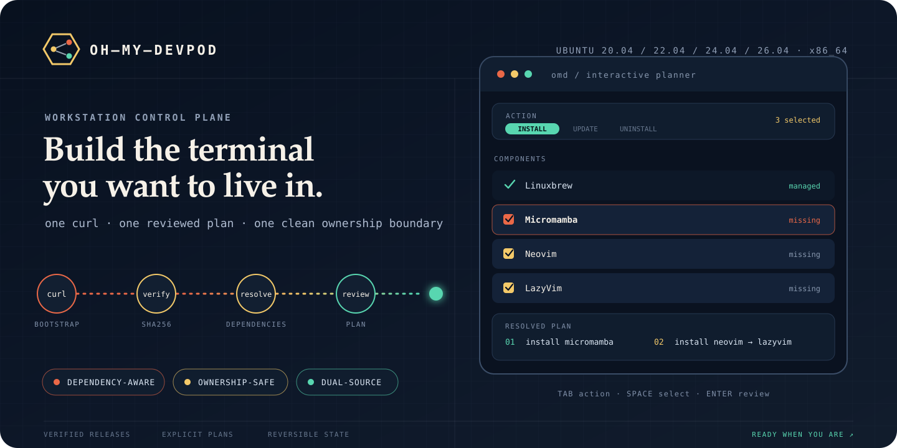

<p align="center">
  
</p>

<p align="center">
  <a href="https://github.com/zhangdw156/oh-my-devpod/releases"></a>
  
  
  
  <a href="./LICENSE"></a>
</p>

<p align="center">
  <strong>English</strong> · <a href="./Readme.osc.md">简体中文</a>
</p>

<p align="center">
  <strong>Turn a fresh Ubuntu machine into a deliberate development environment.</strong><br />
  One verified bootstrap, one dependency-aware plan, and a clean boundary between your tools and ours.
</p>

<p align="center">
  <a href="#quick-start"><strong>Install</strong></a>
  ·
  <a href="#component-catalog"><strong>Explore components</strong></a>
  ·
  <a href="#how-the-tui-works"><strong>See the workflow</strong></a>
  ·
  <a href="#safety-by-construction"><strong>Review safety</strong></a>
</p>

---

## Why oh-my-devpod?

| Plan before changing | Respect what already exists | Choose the closest source |
| --- | --- | --- |
| Select tools, inspect the resolved dependency plan, then execute it. | Existing installations remain external: `omd` does not claim or remove them. | GitHub uses upstream sources; Gitee activates USTC Homebrew and TUNA Python mirrors. |

oh-my-devpod is a focused productivity-tool manager for **Ubuntu 20.04, 22.04, 24.04, and 26.04 x86_64**.
It combines a Rust + Ratatui interface with small shell lifecycle modules, so the
interactive experience stays fast while every install, update, and uninstall
remains explicit and inspectable.

## Quick start

### npm

Use the upstream source profile:

```bash
npm install --global oh-my-devpod
```

Or select the China mirror profile during installation:

```bash
OHMYDEVPOD_SOURCE=gitee npm install --global oh-my-devpod
```

Both commands install the `omd` executable. The npm package supports
Ubuntu 20.04, 22.04, 24.04, and 26.04 on x86_64.

Switch the component download profile at any time without reinstalling:

```bash
omd --source gitee
omd --source github
```

### GitHub · upstream sources

```bash
curl -fsSL https://raw.githubusercontent.com/zhangdw156/oh-my-devpod/main/install/bootstrap.sh | bash
```

### Gitee · China mirrors

```bash
curl -fsSL https://gitee.com/zhangdw156/oh-my-devpod/raw/main/install/bootstrap.sh \
  | OHMYDEVPOD_SOURCE=gitee bash
```

For networks limited to domestic mirrors, allow Gitee, USTC, TUNA, and npmmirror,
and configure APT to use a reachable Ubuntu mirror. The Gitee profile uses USTC
for Homebrew's API and OCI downloads, TUNA for PyPI and Conda, and npmmirror
for uv-managed Python interpreters. GitHub operations through `gh` require
access to GitHub. User-added editor plugins and Git remotes use their own
configured sources.

The bootstrap downloads the complete release bundle, verifies its SHA256
checksum, installs it under your user account, and opens the TUI. After
installation:

```bash
omd
```

> [!NOTE]
> The default binary is `~/.local/bin/omd`. Restart your shell if that directory
> was not already on `PATH`.

## Component catalog

Every component is selectable on its own. Runtime dependencies and
install-time providers are resolved automatically.

| Category | Components | What they cover |
| --- | --- | --- |
| Foundation | **Linuxbrew**, **Zsh**, **uv**, **Micromamba** | User-space packages, shell, and Python/environment tooling |
| Development | **Git**, **GitHub CLI**, **Gitee CLI** | Version control and forge automation |
| Terminal | **ripgrep**, **fzf**, **bat**, **fd**, **jq**, **yq**, **Atuin**, **Zellij**, **Yazi**, **btop**, **witr** | Search, structured data, navigation, history, sessions, files, process tracing, and system visibility |
| Editor | **Neovim**, **LazyVim** | Terminal editing and a managed editor configuration |
| Configuration | **Zsh productivity configuration** | Oh My Zsh, Powerlevel10k, completions, history, fuzzy search, and `z` directory jumping |

For example, this plan adds Micromamba and LazyVim while automatically placing
their providers first:

```bash
omd --plan install micromamba lazyvim
```

```text
requested tools
      │
      ▼
components.toml ── resolve dependencies ── review ordered plan ── execute modules
```

Packages already installed in your personal Linuxbrew satisfy dependencies without being adopted.

## How the TUI works

The interface keeps discovery and mutation separate:

1. **Choose an action** — install, update, or uninstall.
2. **Browse the provider tree** — tools installed through Linuxbrew appear below Linuxbrew and can be folded as one branch.
3. **Select components** — each parent and child keeps its own state, scope, and selection.
4. **Search when needed** — matching children remain visible with their provider ancestors automatically expanded.
5. **Review the plan** — dependencies are ordered before installation; dependants are ordered before removal.
6. **Execute explicitly** — the reviewed plan is revalidated before any module runs.

| Key | Action |
| --- | --- |
| `Tab` | Cycle install / update / uninstall |
| `↑` / `↓` or `j` / `k` | Move through components |
| `←` / `→` or `h` / `l` | Collapse / expand a provider branch |
| `/` | Search components; `Enter` keeps the filter and `Esc` clears it |
| `Space` | Toggle selection |
| `Enter` | Review, then execute |
| `Esc` | Go back or exit |
| `q` | Quit |

## CLI control

Use the TUI for guided operation or the CLI for inspection and automation.

```bash
# Inventory and metadata
omd --list-components
omd --status
omd --version

# Plan without changing the machine
omd --plan install micromamba lazyvim
omd --plan-current uninstall lazyvim neovim
omd --dry-run

# Execute against the current machine state
omd --execute install ripgrep fzf
```

### Self-update and source switching

```bash
omd --update           # update from the saved source
omd --update --github  # update and switch managed sources upstream
omd --update --gitee   # update and switch to China mirrors
omd --source github    # switch sources without updating omd
omd --source gitee     # switch sources without updating omd
```

| Command | Persistent effect |
| --- | --- |
| `omd --update` | Uses `~/.config/oh-my-devpod/source`; invalid or missing configuration falls back to GitHub. |
| `omd --update --github` | Uses GitHub releases and switches managed Homebrew, Micromamba, uv, and pip sources to upstream. |
| `omd --update --gitee` | Uses Gitee releases and switches managed sources to USTC Homebrew plus TUNA Micromamba, uv, and pip mirrors. |
| `omd --source github` | Switches installed OMD-managed package managers and future component operations to upstream sources without updating `omd`. |
| `omd --source gitee` | Switches installed OMD-managed package managers and future component operations to China mirrors without updating `omd`. |

`--github` and `--gitee` are mutually exclusive. A source switch is applied
even when the installed version is already current. Self-update replaces only a
SHA256-verified release bundle—it does not open the TUI or update installed
components. Failed downloads, validation, or activation preserve the active
version and previous source profile.

Legacy `0.14.1` installations may print `previous_dir: unbound variable` after
the newer bundle has already been activated. Run `omd --version`, then rerun
`omd --update` once. Releases from `0.14.4` onward delegate activation to the
verified candidate bootstrap so future installer fixes can cross release
boundaries.

For npm-managed installations, update through npm instead:

```bash
npm update --global oh-my-devpod
```

`omd --update` is intentionally rejected for npm-managed installations so npm
remains the single owner of the installed package. Use `omd --source` to change
the source profile independently of npm package updates.

Source changes apply immediately to OMD-launched component operations. Start a
new managed shell, or re-source
`${OHMYDEVPOD_CONFIG_DIR:-${XDG_CONFIG_HOME:-$HOME/.config}/oh-my-devpod}/env`,
to refresh an interactive shell that was already running.

For tools already installed and owned by OMD, source switching also updates
their native persistent configuration:

- managed Linuxbrew: the `brew` and `homebrew/core` remotes plus
  `${HOMEBREW_PREFIX}/etc/homebrew/brew.env`
- managed uv: `${XDG_CONFIG_HOME:-$HOME/.config}/uv/uv.toml`
- managed Micromamba: `~/.mambarc`
- managed Python environment tooling: user-level `pip.conf`

Switching back to GitHub removes only files generated by OMD. A missing,
modified, or user-owned native configuration is never overwritten; an explicit
source switch fails and rolls back instead. Installed packages and environments
are preserved rather than reinstalled.

Managed Zsh initializes the Mamba shell hook without overriding
`MAMBA_ROOT_PREFIX`; Homebrew-installed Mamba keeps its versioned Cellar root.
It also enables Oh My Zsh's built-in `z` plugin for frecency-based directory
jumping.
After upgrading an existing installation from 0.14.1 or earlier, run
`omd --execute update zsh-config` and start a new shell once.

The Gitee CLI component installs the latest official SHA256-verified Linux
release into `~/.local/bin`. Updating or uninstalling it preserves
`~/.config/gitee`, custom `GITEE_CONFIG_DIR` content, Agent Skills, and login
state.

## Architecture

```text
GitHub / Gitee
      │  versioned archive + SHA256
      ▼
install/bootstrap.sh
      │  activates ~/.local/bin/omd
      ▼
┌──────────────────────── Rust ────────────────────────┐
│  Ratatui interface → catalog → dependency planner   │
│                              → lifecycle runner      │
└──────────────────────────┬───────────────────────────┘
                           │ status / managed / install
                           │ update / uninstall
                           ▼
┌──────────────────────── Shell ───────────────────────┐
│  component modules → tools, config, ownership marks │
└──────────────────────────────────────────────────────┘
```

| Path | Responsibility |
| --- | --- |
| `components.toml` | Single source of truth for components and dependencies |
| `install/bootstrap.sh` | Dual-source, checksum-verified installation |
| `install/update.sh` | Transactional self-update and source switching |
| `crates/omd/` | Rust TUI, catalog validation, planning, and execution |
| `modules/core/`, `modules/tools/` | Component lifecycle implementations |
| `modules/lib/` | Shared ownership and safety primitives |
| `npm/` | npm launcher, install-source selection, and package metadata |
| `build/`, `vendor/`, `config/` | Release assembly and pinned assets |
| `VERSION` | Release version source of truth |

## Per-user Linuxbrew on multi-user hosts

Install and run OMD from each user's own login account. OMD installs Linuxbrew
under `~/.linuxbrew` with that user's ownership. The Brew executable, Cellar,
package metadata, and mirror configuration are private to that installation.
Each user's OMD release, shell and editor configuration, and environment manager
data also use that user's home directories.

On a fresh Ubuntu server, an administrator installs the OS prerequisites once
if they are missing:

```bash
sudo apt-get update
sudo apt-get install -y build-essential procps curl file git ca-certificates
```

Each user then installs OMD and selects Linuxbrew in the TUI, or runs
`omd --execute install linuxbrew`. Bash and Zsh pick up the private Brew and its
tools in a new login shell. OMD installs Zsh and its configuration without
changing the account's default login shell. Run `zsh` to use it.

On Ubuntu 20.04 and 22.04, using the system Python explicitly with `uv venv
--python /usr/bin/python3` requires the OS package `python3-distutils`.

Homebrew bottles that require the standard Linux prefix will build from source
in `~/.linuxbrew`. An existing host-wide Brew is outside OMD's management.
If an older OMD release rejects the new archive, rerun the current bootstrap
from your user account, then install your private Linuxbrew.

## Safety by construction

- **Ownership-gated removal** — only artifacts carrying an oh-my-devpod marker
  can be removed.
- **External installations** — packages already present in personal Linuxbrew stay outside OMD ownership.
- **Dependency-safe plans** — uninstall is blocked while an installed dependant
  would be broken.
- **Protected foundation** — Linuxbrew is excluded from the normal uninstall flow.
- **Configuration preservation** — existing Zsh and Neovim configuration is
  backed up before takeover; user data, caches, and backups survive removal.
- **Verified releases** — archives must pass SHA256 and bundle validation before
  activation.
- **Transactional updates** — source configuration and managed Homebrew remotes
  roll back if self-update cannot complete.

Managed state lives under:

```text
~/.local/bin/omd
~/.local/share/oh-my-devpod/releases/<version>/
~/.local/share/oh-my-devpod/opt/
~/.local/state/oh-my-devpod/
~/.config/oh-my-devpod/
~/.linuxbrew/                       # personal Homebrew and Cellar
```

## Development

The catalog is declarative; each module implements the same
`status` / `managed` / `install` / `update` / `uninstall` contract.

```bash
bash tests/run.sh
cargo fmt --all -- --check
cargo test -p omd
cargo run -p omd -- --version
cargo run -p omd -- --list-components
cargo run -p omd -- --plan install micromamba lazyvim
git diff --check
```

Maintainers build release bundles on Ubuntu 20.04 x86_64 with a Python 3.12
toolchain:

```bash
bash build/build-omd-linux.sh
bash build/package-omd.sh
bash build/package-npm.sh dist/omd-x86_64-unknown-linux-gnu.tar.gz
```

Before publication, test the same release archive and npm package across all
four supported Ubuntu versions:

```bash
bash tests/test-ubuntu-compatibility.sh <release.tar.gz> <package.tgz>
```

Optional trailing versions select a subset for local checks; publication
requires Ubuntu 20.04, 22.04, 24.04, and 26.04 to pass.

See [`DEVELOPMENT.md`](./DEVELOPMENT.md) for module boundaries, ownership rules,
mirror behavior, and release maintenance. npm release bootstrapping is
documented in [`docs/npm-release.md`](./docs/npm-release.md).

---

<p align="center">
  <sub>Built for deliberate terminals: fast to bootstrap, explicit to change, safe to undo.</sub>
</p>
