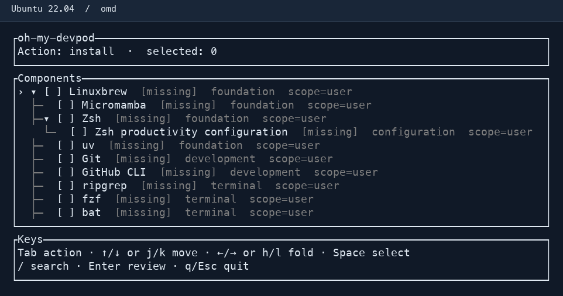

<p align="center">
  
</p>

<p align="center"><a href="./README.md">English</a> · <strong>简体中文</strong></p>

**oh-my-devpod（OMD）** 为当前 Ubuntu 账号安装开发工具。在终端里选好工具，可以先看依赖和安装顺序，再决定是否执行。支持 **Ubuntu 20.04、22.04、24.04 和 26.04 LTS，x86_64 架构**。

[快速开始](#快速开始) · [切换软件源](./docs/guide.zh-CN.md#切换软件源) · [更新 OMD](./docs/guide.zh-CN.md#更新) · [多人服务器](./docs/guide.zh-CN.md#多人服务器)



用空格选中 LazyVim，按 `Enter` 查看计划。LazyVim 为 Neovim 提供配置，所以 Neovim 排在前面。此时按 `Esc` 可以返回，再按一次 `Enter` 才会安装。

## 快速开始

在自己的 Ubuntu 账号中从 Gitee 安装，后续组件下载使用国内镜像。首次配置服务器可先查看[系统依赖](./docs/guide.zh-CN.md#系统依赖)。

```bash
curl -fsSL https://gitee.com/zhangdw156/oh-my-devpod/raw/main/install/bootstrap.sh | OHMYDEVPOD_SOURCE=gitee bash
```

安装脚本校验下载包后自动打开 TUI。以后运行 `omd` 即可再次打开。[GitHub 和 npm 安装方式](./docs/guide.zh-CN.md#安装)

## 先看一份计划

```bash
omd --plan install lazyvim
```

新账号的计划依次列出 Linuxbrew、Git、Neovim 和 LazyVim。多人共用服务器时，每个账号的 Linuxbrew 都在自己的 `~/.linuxbrew`。其中已有的软件包可以满足依赖，仍由你自己管理。

## 组件目录

| 用途 | 可选工具举例 |
| --- | --- |
| Shell 和环境管理 | Zsh、Oh My Zsh 与 Powerlevel10k 配置、uv、Micromamba |
| 编辑与开发 | Neovim、LazyVim、Git、GitHub CLI、Gitee CLI |
| 终端操作 | ripgrep、fzf、jq、Yazi、Zellij、查看磁盘占用的 dust |

运行 `omd --list-components` 可查看完整清单及依赖关系。

[TUI 键位与 CLI 命令](./docs/guide.zh-CN.md#tui-与-cli) · [参与开发](./DEVELOPMENT.md) · [发布指南](./docs/npm-release.md) · [MIT 许可证](./LICENSE)
